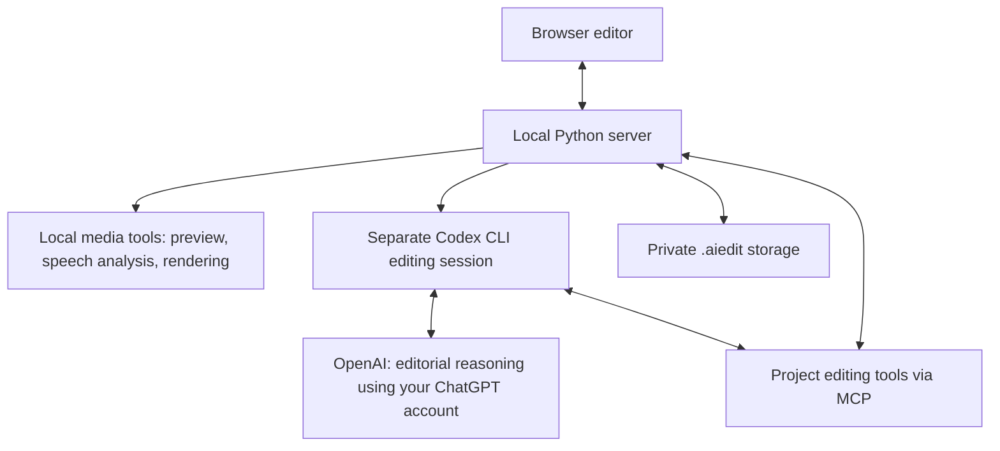

# Reels Factory

Turn a raw talking-head video into a vertical reel: remove pauses, create short captions, add an opening title, and include relevant screenshots or B-roll. Review and adjust the result in a local browser editor before exporting.

**Video processing runs on your computer. Codex handles editorial decisions using your ChatGPT sign-in.** No model API key is required, but AI editing needs internet access and uses your account's Codex access and limits.

## Set it up

The primary setup is **Apple Silicon macOS**. You need [Homebrew](https://brew.sh/), Python 3.12 or newer (uv can install it), and a ChatGPT account with Codex access. Linux requires equivalent media tools and an installed font; AirDrop and iOS Simulator capture require macOS.

### 1. Install the tools and clone the repo

```sh
brew install uv ffmpeg-full whisper.cpp
brew install --cask codex

git clone https://github.com/Bandar1011/ai-editing.git
cd ai-editing
uv sync --locked --group dev
```

FFmpeg needs **libass** to render captions; the app automatically finds Homebrew's `ffmpeg-full`. `whisper.cpp` supplies local speech recognition and word timing. There is no frontend build step, database service, or Docker requirement.

For other Codex installation options, see the [official CLI guide](https://learn.chatgpt.com/docs/codex/cli).

### 2. Download the local speech models

```sh
uv run python scripts/setup_model.py
uv run python scripts/setup_vad.py
```

These download and checksum-verify the multilingual Whisper base model and the Silero speech detector. Whisper transcribes speech; Silero helps locate speech boundaries for tighter cuts. Model downloads happen during setup, not for every video. Silero is optional, but recommended; without its model, the editor reports that it is using recognition gaps instead.

### 3. Sign into Codex and check the setup

```sh
codex login
codex login status
uv run python scripts/doctor.py
```

Complete the browser sign-in with **ChatGPT**. The editing runner requires ChatGPT authentication; API-key sign-in is not used. `doctor.py` checks the media binaries, caption support, and Whisper model. Check Codex sign-in separately with `codex login status`. See [OpenAI's authentication guide](https://learn.chatgpt.com/docs/auth) for sign-in help.

### 4. Start the editor

```sh
./start.sh
```

Open [127.0.0.1:8775](http://127.0.0.1:8775). Leave the terminal running; press **Ctrl+C** to stop. On later visits, run `./start.sh` again. Your saved project reopens on refresh.

## Make your first edit

1. Click **Add video** inside the phone preview, or drop a video onto the page. The original is copied into private project storage; a playable preview and waveform are generated.
2. Click **Prepare video** in **Auto Edit**. Local processing transcribes speech, finds pauses and repeated takes, and creates short captions. Codex starts automatically afterward to make editorial decisions. You do not need to send a separate chat prompt.
3. Review the preview and **AI edit details**, including any unresolved notes. Edit captions, split or delete linked video/audio clips, and drag clip edges to recover trimmed footage. Select an added caption or overlay to move it in the preview. Undo remains available.
4. Click **Export video** when ready. Browser exports are vertical 9:16; every export keeps its own video, captions, and edit snapshot. On a Mac, **Send to my phone** creates or reuses a current export and opens AirDrop so you can choose your iPhone.

Progress appears to the right of the phone only while work is happening. Tracks for captions, overlays, music, effects, or added audio appear only when that content exists.

Want to try it without personal footage? On macOS, `uv run python scripts/create_demo.py --minimal` creates a clearly generated sample. Import the path it prints.

## What the AI actually does

The workflow is the same for each video. Code owns the repeatable operations; Codex makes the decisions that depend on the content.

| Code handles | Codex handles |
| --- | --- |
| Extracting audio, local transcription, and word alignment | Correcting clear transcription mistakes without inventing speech |
| Detecting pauses, proposing cuts, and finding repeated takes | Choosing supported takes and flagging ambiguous deliveries |
| Fixed caption sizes, 1–3-word caption groups, and title formatting | Writing a truthful opening title, at most two lines |
| Rendering overlays, mixing audio, and encoding exports | Choosing useful references and deciding where they belong on screen |
| Caching completed analysis and preserving revisions | Reporting missing assets, uncertainty, and anything needing review |

Titles use a fixed 2.5-second opening duration. Caption and title styling, pause thresholds, and reference sound defaults live in [aiedit/presets.py](aiedit/presets.py). Editing instructions live in [editor.md](editor.md); [AGENTS.md](AGENTS.md) is for engineering work. The built-in [title skill](skills/reel-titles/SKILL.md) guides title wording.

The current Codex runner can read the transcript and inspect selected frames, but **cannot listen to audio**. Word timing, breath detection, and take scoring are imperfect, so review the joins and uncertain wording. Silent screen recordings keep their interaction flow rather than receiving automatic speech cuts.

## How the pieces connect



- **Browser:** the video preview, timeline, captions, and review controls. Built with HTML, CSS, and JavaScript.
- **Python server:** the local app behind the browser. FastAPI receives actions, saves projects, queues work, and reports progress.
- **Media tools:** FFmpeg handles video/audio and rendering; whisper.cpp handles speech recognition/alignment and Silero detection. These run locally.
- **Codex session:** the server launches `codex exec` after preparation. This is a separate editing session, not the coding chat you already have open. Its result and review notes appear in the editor.
- **MCP adapter:** gives that session named editing tools such as reading context, inspecting a frame, fixing captions, adding a title, and placing a reference. It connects to the same revision-checked API as the browser and CLI. The app configures it automatically; there is no MCP setup step for basic editing.

The runner disables shell tools and unrelated integrations. If you change the edit while AI is working, revision checks stop conflicting AI writes. Repeating an identical preparation preserves later human corrections. Failed AI work can be retried with **Retry AI editing** without repeating valid local analysis. Restarting the server interrupts active work; retry it explicitly.

See the [browser workflow](docs/browser-workflow.md) for the complete execution and recovery rules.

## References, sound, and app captures

**B-roll** means supporting visuals shown while the main video continues: a website screenshot, an app recording, or another relevant clip. The private asset library starts empty on a fresh installation; personal media and sound effects are not bundled.

- Import images, clips, and music into your own library. AI can search and inspect those assets.
- Automatic web screenshots require an existing compatible Codex browser connection (`node_repl` in your Codex configuration). Basic editing works without it; unavailable captures become review notes. Browser recording depends on what that connection supports.
- Automatic screenshot/B-roll pop sounds require exactly one audio asset tagged `default-reference-pop`. With the server running, import your sound with:

  ```sh
  python3 scripts/editor.py asset-import /absolute/path/pop.mp3 --tags default-reference-pop
  ```

  New reference overlays use this default unless explicitly opted out. Titles and graphics do not receive a pop. See the [asset guide](docs/minimal-workflow.md#asset-inbox-and-mood-library) for controls and API opt-out.
- Defaults use **Geeza Pro**, a macOS font that is not redistributed here. On other systems, install a licensed font and adjust the preset font families before generating titles/captions.
- Optional same-laptop iOS app captures need Xcode, a Simulator runtime, and a configured app target. They are a separate capture workflow; see [app capture setup](docs/minimal-workflow.md#app-references-on-this-mac). AirDrop needs Apple's command-line developer tools (`xcode-select --install`).

Optional linked-media downloads use `yt-dlp` (`brew install yt-dlp`). Add media you have the right to use; source and rights metadata stay with imported assets.

## Files, privacy, and output quality

```text
.aiedit/
  models/                       Local speech models
  library/                      Your reusable assets and sounds
  projects/<id>/
    source/                     Preserved original video
    working/                    Preview, waveform, transcript, AI attempt logs
    exports/                    Versioned MP4, SRT, and edit manifests
    history/                    Earlier project revisions
    project.json                Current saved edit
```

Uploads and exports stay under `.aiedit/` on your computer. Git ignores its contents except the [storage README](.aiedit/README.md) and an empty placeholder. **Back up this folder separately** to keep your projects, shared library, and editing history.

Local storage does not mean fully offline AI: Codex receives editorial transcript context and selected tool observations, including inspected frames, through OpenAI's account service. The runner does not upload the whole video for cloud transcription or rendering. Optional web captures and media downloads also use the internet. There is no automatic social publishing.

Exports keep earlier versions unchanged. Browser output is an exact 9:16 center crop at the source frame rate; the API/CLI also support native framing. Encoding preserves source HDR transfer and 10-bit HEVC for HDR footage; SDR uses H.264. Exports are re-encoded, not bit-for-bit copies, and HDR playback depends on the browser/display. Preview captions and audio mixing are approximate; check the encoded export before sharing.

## Troubleshooting

| Problem | What to check |
| --- | --- |
| The website will not open | Keep `./start.sh` running and use `http://127.0.0.1:8775`. Check the terminal error if startup exits. |
| AI editing does not start | Run `codex --version` and `codex login status` in the terminal that starts the server. Sign in with ChatGPT, then click **Retry AI editing**. Account limits and internet access still apply. |
| Codex reports an unknown option | Update the CLI using your installation method. The runner needs a recent CLI supporting `codex exec --ignore-user-config`, JSON output, and MCP configuration. |
| Captions or transcription fail | Run `uv run python scripts/doctor.py`. Confirm FFmpeg has libass and the Whisper model is installed. |
| Speech detection fails | Confirm `whisper-vad-speech-segments` is available from whisper.cpp and rerun `uv run python scripts/setup_vad.py` if its model is missing or damaged. |
| References or the pop sound are missing | Import your assets, check the single `default-reference-pop` tag, and read AI review notes. Automatic web capture also needs the browser connection above. |
| Processing was interrupted | Keep the source/project folder, restart the server, and retry the failed operation. Completed analysis can be reused; do not delete the project to retry. |

Longer videos and slower hardware take longer. Cached analysis avoids repeated work; it cannot guarantee identical editing times for every video.

## Terminal use and development

The server must be running. The CLI uses the same API as the browser:

```sh
python3 scripts/editor.py import /absolute/path/clip.mp4
python3 scripts/editor.py prepare PROJECT_ID --language auto --max-words 3 --wait
python3 scripts/editor.py status PROJECT_ID
python3 scripts/editor.py retry-ai PROJECT_ID --wait
python3 scripts/editor.py export PROJECT_ID --format vertical --label "Review" --wait
```

`prepare --wait` follows local preparation and automatic AI editing. Use `retry-ai` only if that AI pass needs another attempt. The [minimal workflow guide](docs/minimal-workflow.md) covers targeted edits, assets, feedback, and capture commands. Local API documentation is at [127.0.0.1:8775/docs](http://127.0.0.1:8775/docs).

Optional environment variables: `AIEDIT_PORT`, `AIEDIT_DATA`, `AIEDIT_MODEL`, `AIEDIT_DTW_MODEL`, `AIEDIT_VAD_MODEL`, and `AIEDIT_URL` for the CLI. Defaults use port `8775` and `.aiedit/`. Model setup scripts always write into the repo's `.aiedit/models/`; with a custom data directory, set the model paths explicitly. The server always binds to `127.0.0.1`.

```sh
uv run --group dev pytest -q
node --check web/app.js
node --check web/production.js
node --check web/canvas.mjs
node --test tests/*.test.mjs
```

Node.js is needed for the JavaScript checks, not to serve the editor. Tests use generated media; CI does not need your footage or a signed-in Codex account. Native captures and AirDrop require separate checks on a configured Mac.

The workflow draws on [George Wang's editing resource pack](https://246bfcda.ht-ml.app/) and evolved from the creator's Local Cut workspace. See [workflow notes](docs/workflow.md) for tool choices.
